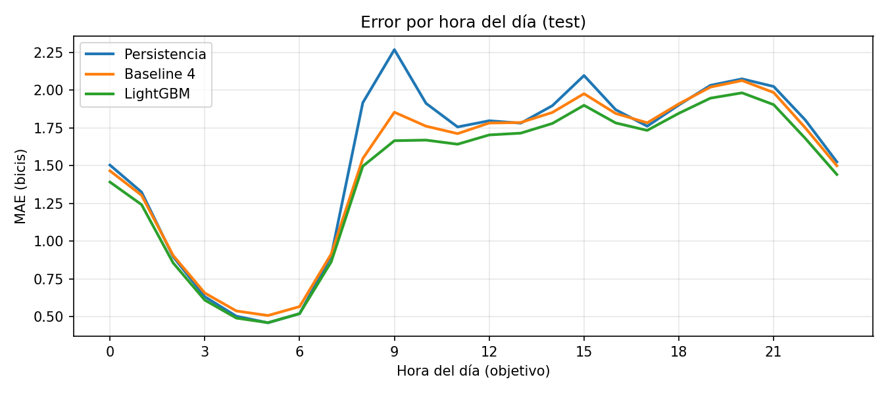
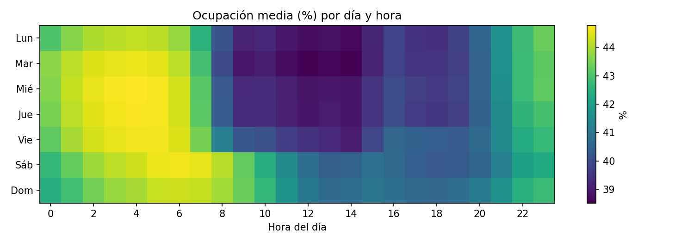
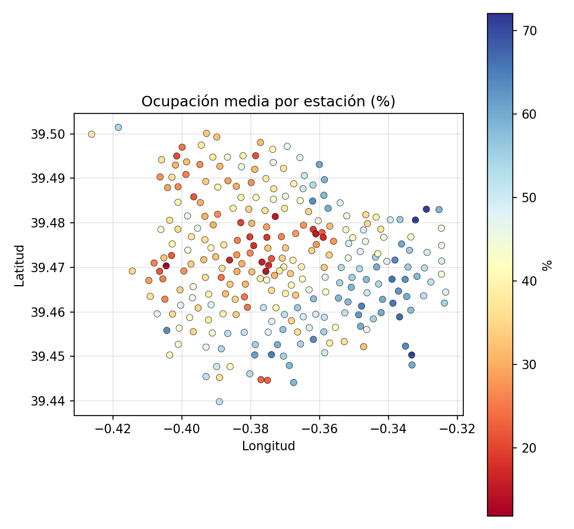

# 🚲 Valenbisi: alerta temprana de estaciones que se quedarán sin bicis

Predicción, con una hora de antelación, de la disponibilidad de bicicletas en las 273 estaciones de Valenbisi (València), comparando una red neuronal recurrente (GRU) con baselines simples y con LightGBM.

**▶ Demo:** https://huggingface.co/spaces/pablozueco/valenbisi-alerta
*(repetición de datos históricos de test, no es una predicción en directo)*

---

## Resumen

- **Datos:** ~25 millones de registros (una captura cada 15 minutos, dic 2022 – sep 2025) de las 273 estaciones.
- **Tarea:** dado el estado de las últimas 4 horas, ¿cuántas bicis habrá dentro de 1 hora y se quedará la estación **vacía**?
- **Resultado principal:** la GRU reduce el error medio un **5,6 %** frente al mejor baseline (1,416 frente a 1,499 bicis). **LightGBM obtiene un resultado equivalente** (1,430).
- **El objetivo inicial no se alcanzó.** Me propuse mejorar un 15 % al mejor baseline. A una hora vista, "lo que hay ahora" ya contiene casi toda la información predecible, y el margen real es mucho menor.
- **Hallazgo útil:** como detector de estaciones que hoy tienen bicis y en una hora estarán vacías (un 4,8 % de los casos), los modelos superan con claridad a las reglas sencillas.

## Resultados

Evaluación en test (1 mar – 24 sep 2025, 2,64 millones de predicciones). Error medio absoluto (MAE) en bicis; menor es mejor.

| Método | MAE | MAE (% de la capacidad) |
|---|---|---|
| Persistencia ("dentro de 1 h, lo mismo que ahora") | 1,548 | 7,97 % |
| Misma hora de la semana anterior | 4,77 | 24,8 % |
| Perfil medio (día de la semana × hora) | 4,38 | 22,5 % |
| Persistencia + cambio típico (**mejor baseline**) | 1,499 | 7,77 % |
| LightGBM (un modelo para todas las estaciones) | 1,430 | 7,42 % |
| **GRU** (media de 5 entrenamientos, ±0,001) | **1,416** | 7,35 % |
| Conjunto de 5 GRU | 1,414 | – |

Mejora frente al mejor baseline: LightGBM 4,6 %; GRU 5,6 %. Entre ellos, la diferencia es de ~1 %: cada modelo gana en una métrica.

### ¿Dónde aporta valor el modelo?

El error depende mucho de la hora. En la punta de la mañana (8–9 h) el modelo mejora a la persistencia en torno a un **22–27 %**; el resto del día la mejora frente al mejor baseline es de un 3–5 %.



### Detección de estaciones que se vaciarán

Subgrupo: estaciones que **hoy tienen bicis** (2,38 millones de casos). En él, un 4,8 % se vacía en la siguiente hora.

| Método | Precisión media (AP) | Recall con ≥30 % de precisión |
|---|---|---|
| Regla: "quedan pocas bicis" | 18,6 % | 0 % |
| Persistencia + cambio típico | 25,1 % | 29,6 % |
| LightGBM (clasificador) | 31,3 % | 48,7 % |
| **GRU (clasificador)** | 31,1 % | 49,8 % |

Es una señal real, pero modesta: para detectar la mitad de los vaciados, aproximadamente 7 de cada 10 avisos son falsas alarmas.

## Metodología

1. **Datos.** Dataset [`femartip/valencia-urban-mobility`](https://huggingface.co/datasets/femartip/valencia-urban-mobility) (Hugging Face), que recopila el estado de las estaciones publicado por el Ajuntament de València.
2. **Calidad y limpieza.** Un archivo corrupto descartado; sin duplicados ni nulos; 4 estaciones excluidas (105, 146, 168 y 299 dejan de existir el 23-10-2024); filas "offline" (0 bicis y 0 huecos) marcadas como valor ausente; redondeo a bloques de 15 min y matriz *tiempo × estación* (98.681 × 273, un 8,8 % de celdas vacías, sobre todo por días enteros que faltan).
3. **Partición temporal (nunca aleatoria).**
   - Entrenamiento: 01-12-2022 → 30-09-2024
   - Validación: 01-10-2024 → 28-02-2025
   - Test: 01-03-2025 → 24-09-2025
4. **Baselines.** Persistencia, misma hora de la semana anterior, perfil medio y persistencia + cambio típico.
5. **LightGBM.** Un único modelo global que predice el cambio de bicis en la próxima hora (pérdida L1), más un clasificador específico para "estación vacía".
6. **GRU.** Lee las últimas 4 h (16 pasos) de cada estación más variables estáticas (capacidad, coordenadas, hora y día del objetivo, perfil típico, valor de ayer y de la semana anterior). Dos salidas: cambio de bicis (L1) y probabilidad de estar vacía (entropía cruzada). 8 épocas, la mejor elegida con **validación**. Entrenada con 5 semillas para medir la variabilidad.

## Exploración de datos

<p>


</p>

El centro y el oeste de la ciudad tienden a vaciarse; el este y el sureste, hacia el mar, a llenarse. La ocupación media de toda la ciudad apenas varía durante el día (≈6 puntos): las bicis no desaparecen, cambian de sitio. Por eso se predice por estación.

## Limitaciones (léelas antes de sacar conclusiones)

- **Objetivo inicial no cumplido:** reducir un 15 % el error del mejor baseline. Se logró un ~5,5 %.
- **El segundo objetivo (alerta de estaciones vacías) se definió después de explorar los datos**, no al inicio del proyecto.
- **Uso repetido del test:** el conjunto de test se consultó varias veces durante el análisis (por ejemplo, al elegir umbrales de aviso para comparar métodos). Las comparaciones entre métodos son justas, pero las cifras absolutas pueden ser algo optimistas. Las decisiones de modelado de la GRU se tomaron con validación.
- **GRU y LightGBM no son comparables al 100 %:** LightGBM se entrenó con una muestra menor de orígenes y no se ajustó tanto como la red.
- **Saltos bruscos no predecibles:** reposiciones de bicis o averías dominan los errores grandes.
- **Datos incompletos:** faltan unos 78 días, entre ellos las Fallas de 2024 (15–20 de marzo), así que el análisis de ese evento no es posible para ese año.
- **Sin meteorología ni calendario de eventos.**
- **No es en directo:** el histórico termina en septiembre de 2025 y el endpoint original del portal dejó de responder, por lo que la demo reproduce datos pasados.

## Estructura del repositorio

```
├── app.py                 # demo (Gradio) desplegada en Hugging Face Spaces
├── requirements.txt
├── data/                  # predicciones de test usadas por la demo
├── notebooks/
│   └── valenbisi.ipynb    # análisis completo, de los datos a los modelos
├── images/                # figuras del README
└── README.md
```

## Cómo reproducirlo

1. Abre `notebooks/valenbisi.ipynb` en Google Colab (activa **GPU** para la GRU).
2. Ejecuta las celdas en orden. Los datos se descargan de Hugging Face (~200 MB) y los resultados intermedios se guardan en Google Drive.

Para ejecutar la demo en local:

```bash
pip install gradio plotly pandas pyarrow
python app.py
```

## Fuentes y licencia

- Datos: Ajuntament de València, portal de datos abiertos (licencia CC-BY 4.0). Recopilación histórica: `femartip/valencia-urban-mobility`.
- Código: indica aquí la licencia que prefieras (por ejemplo, MIT).

## Autor

**Pablo Zueco** · [LinkedIn](www.linkedin.com/in/pablo-zueco-herrero-621388402) · [Hugging Face](https://huggingface.co/pablozueco)
